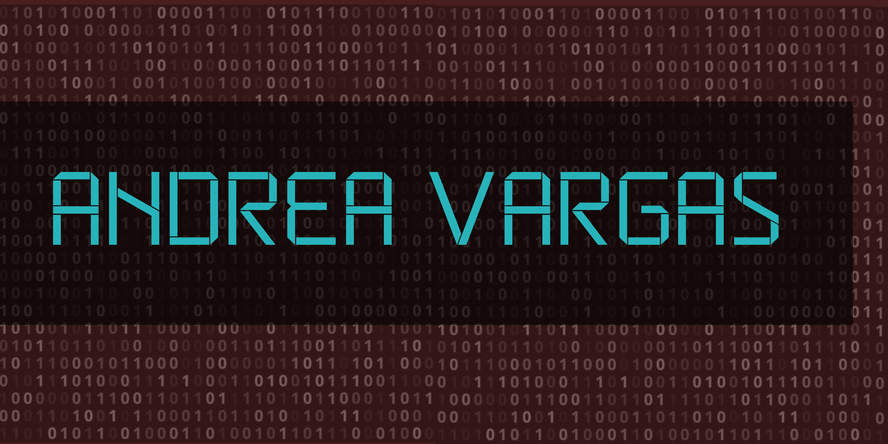

  

<h1 align="center">I'm a Computer Science Student & Developer</h1>
<h3 align="center">Passionate about building organized systems, art and documenting every step of the journey.</h3>

 

---

### 💻 Tech Stack & Tools

  <!-- Lenguajes, Web y Herramientas Principales -->
  
   
  <!-- Backend, Bases de Datos, Motores y Productividad -->
  

---

### 🌱 Currently Learning

  

---
### 📈 GitHub Metrics

  

  

  

---

### Heartbeat

  

