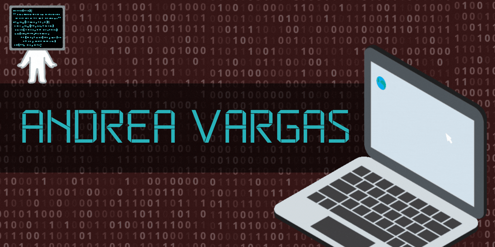

  

<h1 align="center">I'm a Computer Science Student & Developer</h1>
<h3 align="center">Passionate about building organized systems, art and documenting every step of the journey.</h3>

 

---
### 📫 Connect with Me

  
  &nbsp;&nbsp;&nbsp;
  
  &nbsp;&nbsp;&nbsp;

---

### 💻 Tech Stack & Tools

  <!-- Fila 1 -->
  
  
  
  
   
  <!-- Fila 2 -->
  
  
  
  
  

---

### 🌱 Currently Learning

  <!-- Fila 1 -->
  
  
  
  
   
  <!-- Fila 2 -->
  
  
  
  

---
### 📈 GitHub Metrics

  

  

---
### Heartbeat

  

